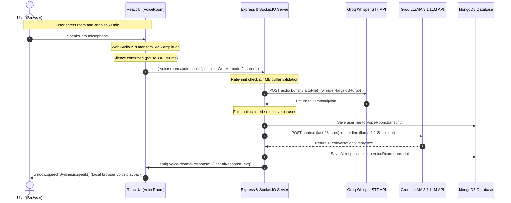
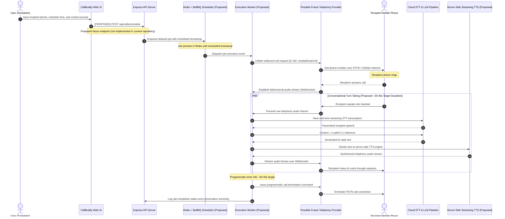
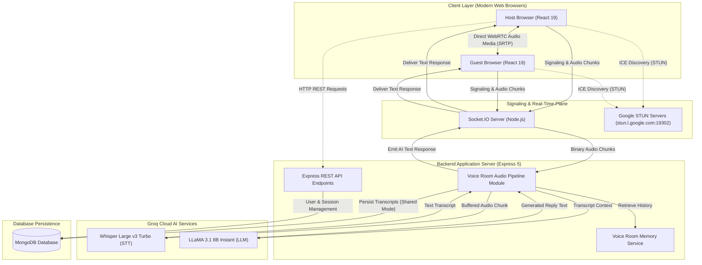
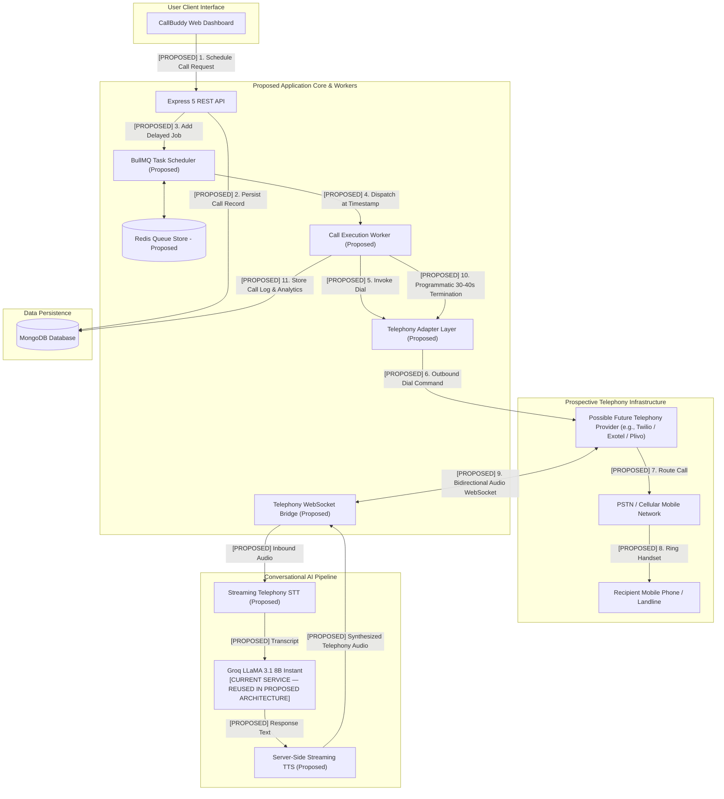

# CALLBUDDY AI — TECHNICAL ARCHITECTURE AND SYSTEM FLOW

**Project Name:** CallBuddy AI  
**Author / Developer:** Rishi Kumar Shaw  
**Institution:** Brainware University  
**Document Type:** Technical Architecture & System Flow Specification  
**System Release / Stage:** CallBuddy AI v3 (Academic Prototype)  
**Date:** September 2026  

---

> **EXECUTIVE STATUS SUMMARY**  
> * **Current Operational System:** Browser-based real-time communication platform utilizing WebRTC peer-to-peer audio mesh, Socket.IO signaling, chunk-based Groq Whisper speech transcription, contextual Groq LLaMA 3.1 inference, MongoDB persistence, and client-side browser speech synthesis.  
> * **Original Project Vision:** Scheduled autonomous telephone calls placed to standard mobile/landline numbers over the public switched telephone network (PSTN).  
> * **PSTN Telephony Status:** **PROPOSED / NOT IMPLEMENTED** (no carrier accounts, SIP trunks, outbound dialing, telephony media streaming, or server-side telephone TTS are currently deployed or functional in this repository).

---

## 1. Document Status, Scope & Implementation Boundary

This document serves as the formal technical architecture and system-flow specification for the **CallBuddy AI** project (v3 release). Its objective is to provide academic evaluators, software engineering reviewers, and technical committees with an accurate, transparent, and comprehensive breakdown of the platform's architectural layers, data pathways, security controls, and design limitations.

### Current Implementation Boundary

> **CURRENT IMPLEMENTATION BOUNDARY:**  
> The present repository codebase ends at browser-based WebRTC communication and cloud AI processing. It does not cross into the public telephone network. PSTN connectivity, telephone scheduling, carrier integration, telephony media streaming, server-side telephone TTS, and automated telephone termination belong entirely to the proposed future architecture.

### Implementation Status Legend

To ensure complete transparency and prevent ambiguity between working software and forward-looking designs, all features, modules, and diagrams in this document are categorized using the following standardized status indicators:

* `[IMPLEMENTED]`: Present in the current repository codebase and part of the current working prototype.
* `[PROTOTYPE]`: Partially implemented, demonstration-oriented, or UI/preview functionality whose complete end-to-end operational workflow is not active.
* `[PROPOSED / FUTURE]`: Conceptual architectural design planned for future development phases; no running service, queue, or adapter currently exists in the codebase.
* `[NOT IMPLEMENTED]`: No functional code or external provider integration exists in the repository for this capability.

### Technical Contribution & Technology Integration Notice

CallBuddy AI integrates established, industry-standard technologies and open-source frameworks, including React, Node.js, Express, Socket.IO, native browser WebRTC APIs, MongoDB, Groq Cloud AI services (Whisper and LLaMA 3.1), and browser Web Speech APIs. 

The academic and engineering contribution of this project resides in:
1. The end-to-end system architecture and orchestration logic connecting browser voice capture, peer-to-peer media mesh, and cloud inference pipelines.
2. The custom client-side Voice Activity Detection (VAD) and RMS monitoring pipeline implemented via the Web Audio API.
3. The server-side audio ingestion, validation, hallucination-filtering, and conversation memory aggregation layer.
4. The private versus shared multi-user AI interaction model inside collaborative WebRTC voice rooms.
5. The architectural specification of an abstracted telephony bridge for prospective PSTN expansion.

The project does **not** claim invention of WebRTC, STUN protocols, Socket.IO, Whisper, LLaMA, MongoDB, or browser speech synthesis engines. The original PSTN-based concept may be evaluated separately for intellectual-property considerations; this document does not assert patentability or legal novelty.

---

## 2. System Overview

Architecturally, CallBuddy AI is structured into two clearly demarcated layers:

```text
========================================================================================
1. CURRENT OPERATIONAL SYSTEM [IMPLEMENTED]
========================================================================================

  [Browser A (Host)] ◄═══════════ WebRTC Audio Media (P2P) ══════════► [Browser B (Guest)]
          │                                                                   ▲
   Socket.IO Signaling &                                                      │
   Chunked Audio Upload                                               Browser Native
          │                                                          SpeechSynthesis
          ▼                                                                   │
  [Node.js / Express Server] ──► [Groq Whisper STT] ──► [Groq LLaMA 3.1 8B] ──┘
          │
          ▼
  [MongoDB Database] (Users, Sessions, VoiceRooms, Conversation Records)

========================================================================================
2. PROPOSED FUTURE SYSTEM — NOT IMPLEMENTED [PROPOSED / FUTURE]
========================================================================================

  [Client Call Studio] ──► [Express API] ──► [MongoDB Record] ──► [Redis / BullMQ Queue]
                                                                          │
                                                                 (Scheduled Timestamp)
                                                                          ▼
  [Mobile Recipient] ◄── [PSTN Carrier] ◄── [Telephony Adapter] ◄── [Execution Worker]
          │
     Bidirectional
     Telephony Audio
     (WebSocket)
          ▼
  [Server STT] ──► [Context + LLaMA 3.1] ──► [Server-Side Streaming TTS] ──► [Carrier Audio]
```

### Current Operational System Description `[IMPLEMENTED]`
A browser-based real-time communication platform consisting of multi-user WebRTC voice rooms, persistent text chat, voice-to-text chat input, automated microphone speech segmentation, contextual AI conversational responses, and browser-based speech synthesis. Human participants communicate through direct WebRTC peer-to-peer audio media, with WebRTC providing encrypted media transport. Concurrently, an AI participant operates asynchronously by receiving segmented audio chunks through Socket.IO, transcribing them via Groq-hosted Whisper Large v3 Turbo, evaluating conversational context, generating replies using Groq-hosted LLaMA 3.1 8B Instant, and emitting plain text back to the browser for client-side vocalization.

### Proposed Future System Description `[PROPOSED / FUTURE]`
A proposed autonomous scheduled telephone calling architecture designed to initiate automated outbound telephone calls over the Public Switched Telephone Network (PSTN) to conventional mobile phones and landlines. This prospective architecture incorporates an abstracted Telephony Adapter Layer, a Redis-backed BullMQ persistent delayed task queue, bidirectional telephony media streaming over WebSockets, server-side streaming speech synthesis, and programmatic call duration monitoring. **This subsystem is not implemented in the current repository.**

---

## 3. Current vs. Proposed Architecture Summary

### Comparative Architectural Matrix

The following matrix provides a direct, evaluator-friendly comparison between the current working prototype and the proposed telephony expansion:

| System Capability | Current Operational System | Proposed Telephony Architecture | Current Repository Status |
| :--- | :--- | :--- | :--- |
| **End-User Device** | Modern desktop/mobile web browser | Standard mobile phone or landline handset | Browser: `[IMPLEMENTED]`<br>Handset: `[NOT IMPLEMENTED]` |
| **Voice Transport** | Native WebRTC peer-to-peer audio mesh (`RTCPeerConnection`) | Public Switched Telephone Network (PSTN) via carrier trunking | WebRTC: `[IMPLEMENTED]`<br>PSTN: `[NOT IMPLEMENTED]` |
| **Signaling Plane** | Socket.IO duplex event channel | Carrier REST webhooks and bidirectional media WebSockets | Socket.IO: `[IMPLEMENTED]`<br>Telephony: `[NOT IMPLEMENTED]` |
| **Network Discovery** | Google STUN (`stun.l.google.com:19302`) for ICE candidate gathering | Carrier cellular routing and PSTN switching infrastructure | STUN: `[IMPLEMENTED]`<br>PSTN: `[NOT IMPLEMENTED]` |
| **Voice Input Capture** | Browser Web Audio API (`AudioContext`, `AnalyserNode`, RMS monitoring) | Continuous carrier audio stream over WebSocket (e.g., 8 kHz G.711 $\mu$-law) | Web Audio: `[IMPLEMENTED]`<br>Carrier Stream: `[NOT IMPLEMENTED]` |
| **Speech Segmentation** | Client-side silence detection (~1700ms pause) via `MediaRecorder` | Proposed server-side streaming VAD or carrier speech events | Client VAD: `[IMPLEMENTED]`<br>Server VAD: `[PROPOSED]` |
| **Audio Chunk Format** | WebM container encoding 48 kHz Opus audio | Provider-dependent telephony audio, e.g. 8 kHz G.711 $\mu$-law | WebM/Opus: `[IMPLEMENTED]`<br>G.711: `[NOT IMPLEMENTED]` |
| **Speech Recognition** | Groq-hosted Whisper Large v3 Turbo (buffered chunk upload) | Proposed near-real-time streaming STT pipeline for telephony frames | Groq Whisper: `[IMPLEMENTED]`<br>Streaming STT: `[PROPOSED]` |
| **Conversational LLM** | Groq-hosted LLaMA 3.1 8B Instant (non-streamed completion) | Proposed streaming token generation to reduce conversational turn-taking latency | Groq LLaMA: `[IMPLEMENTED]`<br>Token Stream: `[PROPOSED]` |
| **Speech Synthesis (TTS)** | Browser-native `window.speechSynthesis` (OS local voices) | Server-side / cloud streaming TTS producing carrier-compatible audio | Browser TTS: `[IMPLEMENTED]`<br>Server TTS: `[NOT IMPLEMENTED]` |
| **Execution Trigger** | User manual room creation / joining via web interface | Autonomous delayed execution via task scheduler at scheduled timestamp | User Trigger: `[IMPLEMENTED]`<br>Scheduler: `[NOT IMPLEMENTED]` |
| **Call Duration Policy** | Uncapped participant sessions; manual room exit by user | Proposed target conversation duration: approximately 30–40 seconds with programmatic hangup | Manual Exit: `[IMPLEMENTED]`<br>Auto Hangup: `[NOT IMPLEMENTED]` |
| **Data Persistence** | MongoDB via Mongoose (Users, sessions, voice rooms, transcripts) | MongoDB (Users, call configs, delivery logs, billing records) | Active Models: `[IMPLEMENTED]`<br>Call Models: `[PROPOSED]` |

### Implementation Status by Subsystem & Capability

| Capability / Module | Current Status | Operational Details in Repository |
| :--- | :--- | :--- |
| **Browser-based Calling Room** | `[IMPLEMENTED]` | Multi-user collaborative audio room with host/guest controls |
| **WebRTC Communication** | `[IMPLEMENTED]` | Direct WebRTC peer-to-peer audio media, with WebRTC providing encrypted media transport |
| **Socket.IO Signaling & Transport**| `[IMPLEMENTED]` | Relays SDP offers, answers, ICE candidates, and client audio chunks |
| **Browser Microphone Capture** | `[IMPLEMENTED]` | Browser Web Audio API volume analysis and `MediaRecorder` chunking |
| **Chunk-Based AI Voice Pipeline** | `[IMPLEMENTED]` | Web Audio RMS volume analysis with ~1700ms silence confirmation window |
| **Groq Whisper Transcription** | `[IMPLEMENTED]` | Cloud transcription of buffered WebM audio chunks via Whisper Large v3 Turbo |
| **Groq LLaMA Response Generation**| `[IMPLEMENTED]` | Non-streamed cloud conversational inference incorporating past 28 room turns |
| **Browser SpeechSynthesis TTS** | `[IMPLEMENTED]` | Client-side vocalization using browser `window.speechSynthesis` API |
| **MongoDB Persistence** | `[IMPLEMENTED]` | Persistent storage of user accounts, rooms, sessions, and transcripts |
| **Phone-Number Call Studio UI** | `[PROTOTYPE]` | Prototype UI mockup with locked inputs; no actual telephone call is placed |
| **Call Preview Generator** | `[PROTOTYPE]` | REST endpoint generating an illustrative 4-step structured call outline |
| **PSTN Integration** | `[NOT IMPLEMENTED]` | No carrier connection, telecom trunks, or phone dialing capabilities |
| **Real Mobile/Landline Dialing** | `[NOT IMPLEMENTED]` | System cannot initiate or terminate calls over cellular or landline networks |
| **Telephone Scheduling** | `[NOT IMPLEMENTED]` | No background scheduler or automated dialing daemon active |
| **Telephony Media Bridge** | `[PROPOSED / FUTURE]` | Architectural design for receiving/streaming telephony audio over WebSockets |
| **Server-Side Telephone TTS** | `[PROPOSED / FUTURE]` | Architectural requirement for generating carrier-compatible audio streams |
| **Future Scheduler / Delayed Calls**| `[PROPOSED / FUTURE]` | Proposed Redis/BullMQ delayed job queue subject to worker infrastructure |
| **Automated PSTN Termination** | `[PROPOSED / FUTURE]` | Proposed automated termination based on duration, conversation state, or carrier controls |

---

## 4. Principal Technology Stack Table

This document describes the principal technologies, frameworks, libraries, browser APIs, and external services identified in the repository:

### Current Technologies (Identified in Repository)

| Layer / Domain | Technology / Component | Version / Identifier | Operational Role in Codebase | Source Reference |
| :--- | :--- | :--- | :--- | :--- |
| **Frontend Framework** | React | `^19.2.7` | Reactive component tree, state hooks, and DOM rendering | `frontend/package.json` |
| **Frontend Build Tool** | Vite | `^8.1.0` | Development server, HMR, and production ESM bundler | `frontend/package.json` |
| **HTTP Client** | Axios | `^1.18.1` | REST API requests to backend endpoints | `frontend/package.json` |
| **UI Iconography** | Lucide React | `^1.21.0` | Visual indicators and iconography for dark-mode interface | `frontend/package.json` |
| **Real-Time Client** | Socket.IO Client | `^4.8.3` | WebRTC signaling exchange and binary audio chunk transport | `frontend/package.json` |
| **Peer-to-Peer Media** | Native WebRTC | Browser W3C Standard | Direct browser-to-browser audio media (`RTCPeerConnection`) | `frontend/src/VoiceRoom.jsx` |
| **Voice Activity Detection**| Web Audio API | Browser W3C Standard | Audio graph, RMS volume calculation via `AnalyserNode` | `frontend/src/VoiceRoom.jsx` |
| **Speech Synthesis (TTS)** | Web Speech API | Browser W3C Standard | Client-side playback of AI responses via `window.speechSynthesis` | `frontend/src/VoiceRoom.jsx` |
| **Backend Runtime** | Node.js | v20+ / v24 (LTS) | Server execution environment | `backend/package.json` |
| **Backend Framework** | Express.js | `^5.2.1` | HTTP routing, middleware pipeline, and REST API controllers | `backend/package.json` |
| **Real-Time Server** | Socket.IO Server | `^4.8.3` | Room management, signaling relay, and binary audio uploader | `backend/package.json` |
| **Application Database** | MongoDB via Mongoose | `^9.7.2` | Document database for persistence; local or hosted instance | `backend/server.js` |
| **User Authentication** | JSON Web Tokens (JWT) | `^9.0.3` | Stateless bearer token generation and authorization verification | `backend/package.json` |
| **Password Security** | bcryptjs | `^3.0.3` | One-way cryptographic password hashing (salt rounds: 12) | `backend/package.json` |
| **Speech Recognition API** | Groq Whisper API | `whisper-large-v3-turbo` | Cloud-hosted multilingual audio chunk transcription | `backend/services/speechProvider.js` |
| **Conversational LLM API** | Groq LLaMA API | `llama-3.1-8b-instant` | Fast cloud-hosted inference for conversational dialogue generation | `backend/services/voiceRoomAi.js` |
| **AI Integration SDK** | OpenAI Node.js SDK | `^6.44.0` | OpenAI-compatible client configured to Groq API endpoint | `backend/package.json` |
| **Network Tunneling** | Cloudflare Tunnel | Binary (`cloudflared`) | Development-time public HTTPS exposure during testing | `backend/server.js` |

> [!NOTE]
> **Database Configuration**: The application connects to MongoDB using Mongoose; deployment may use a local or hosted MongoDB instance depending on configuration. In the development environment, custom DNS nameservers (`1.1.1.1`, `8.8.8.8`) are configured to avoid SRV record resolution issues on specific Node 24 Windows environments. MongoDB stores user accounts, authentication records, chat sessions, voice rooms, and shared transcripts.

> [!NOTE]
> **Cloudflare Tunnel Usage**: Development-time public HTTPS exposure can be provided using Cloudflare Tunnel (`*.trycloudflare.com`) during testing or multi-device demonstration. It does not replace application-level security controls or serve as a permanent production firewall.

### Proposed Future Technologies (Planned Telephony Architecture)

| Layer / Domain | Prospective Technology | Architectural Role in Proposed Subsystem | Implementation Status |
| :--- | :--- | :--- | :--- |
| **Task Queue & Scheduler** | Redis + BullMQ | Persistent delayed job scheduling and worker retry management | `[PROPOSED / FUTURE]` |
| **Telephony Gateway** | Carrier Provider / SIP Trunk | Outbound telephone dialing and PSTN cellular routing (Examples: Twilio, Exotel, Plivo) | `[PROPOSED / FUTURE]` |
| **Telephony Audio Format**| 8 kHz G.711 $\mu$-law | Provider-dependent binary audio frame format for telephone networks | `[PROPOSED / FUTURE]` |
| **Streaming STT** | Telephony Streaming STT | Continuous frame-by-frame speech recognition over WebSockets | `[PROPOSED / FUTURE]` |
| **Server-Side TTS** | Streaming Cloud / Server TTS | Low-latency audio synthesis delivering telephony-compatible audio streams | `[PROPOSED / FUTURE]` |

---

## 5. Frontend Architecture

The frontend is implemented as a single-page application (SPA) using React 19 and Vite. The user interface does not use third-party client-side routing libraries such as React Router; instead, it implements a lightweight, native pathname inspection pattern (`window.location.pathname`).

```text
                           [ index.html ]
                                 │
                           [ main.jsx ] (RootRouter)
                                 │
            ┌────────────────────┴────────────────────┐
            ▼                                         ▼
     [ AuthPage.jsx ]                            [ App.jsx ]
     (Login / Register)                     (Authenticated Hub)
                                                      │
                       ┌──────────────────────────────┼──────────────────────────────┐
                       ▼                              ▼                              ▼
                 [ Chat View ]                 [ Call Studio ]                 [ Side Drawers ]
             (Text & Mic Input)               (Prototype Preview)             (Sessions & Memory)

  ──────────────────────────────────────────────────────────────────────────────────────────
     [ VoiceRoom.jsx ] ◄── Mounted directly when path matches "/voice-room/:roomId"
     (WebRTC Mesh Peer Connection, Web Audio VAD, Socket.IO Signaling, Browser SpeechSynthesis)
```

### Component Breakdown & Responsibilities

#### 1. `RootRouter` (`frontend/src/main.jsx`) `[IMPLEMENTED]`
* Inspects `window.location.pathname` upon initialization.
* If the pathname matches `/voice-room/:roomId`, it immediately mounts `<VoiceRoom />`, allowing invited participants to join a room without navigating through the main dashboard.
* If on `/`, it inspects `localStorage` for an existing JWT token (`callbuddy_token`) and validates the session against the backend via `GET /api/auth/me`.
* Renders `<AuthPage />` if unauthenticated, or `<App />` if authenticated.

#### 2. `AuthPage` (`frontend/src/AuthPage.jsx`) `[IMPLEMENTED]`
* Manages user registration (`POST /api/auth/register`) and login (`POST /api/auth/login`).
* Validates inputs, handles server-side error responses, stores issued JWT tokens in `localStorage`, and updates parent authentication state.

#### 3. `App` (`frontend/src/App.jsx`) `[IMPLEMENTED / PROTOTYPE]`
* Serves as the primary authenticated workspace containing three major functional panels:
  * **Persistent Text Chat (`[IMPLEMENTED]`)**: Interactive text chat with LLaMA-based response generation and persistent message history, displaying message history, timestamps, and memory snapshots.
  * **Chat Voice Input (`[IMPLEMENTED]`)**: Allows users to record voice notes via `MediaRecorder`, uploads the resulting audio blob to `POST /api/speech/transcribe`, and populates the text input field with the returned transcription.
  * **Voice Room Dispatcher (`[IMPLEMENTED]`)**: Calls `POST /api/voice-rooms` to generate a collaborative voice room, builds the shareable room URL, and redirects the host.
  * **Call Studio Panel (`[PROTOTYPE]`)**: A locked, non-operational prototype user interface demonstrating the proposed phone configuration workflow. Users can enter a recipient name, phone number, and conversation topic, and trigger `POST /api/call-preview` to view an illustrative 4-step structured call script outline. The interface is locked for demonstration purposes: no actual telephone call is placed, no PSTN provider is integrated, scheduling is not implemented, and the phone recipient does not receive a call.

#### 4. `VoiceRoom` (`frontend/src/VoiceRoom.jsx`) `[IMPLEMENTED]`
* The central real-time component managing multi-user WebRTC audio and AI voice interaction:
  * **Peer Connection Lifecycle**: Maintains `peerConnectionsRef` (`Map<peerId, RTCPeerConnection>`), negotiating SDP offers/answers and exchanging ICE candidates via Socket.IO.
  * **Audio Stream Separation**: Separates the microphone into a human communication track (`localStreamRef` sent over WebRTC) and an AI listening track (`aiStreamRef`).
  * **Voice Activity Detection (VAD)**: Initializes an `AudioContext` and `AnalyserNode` to compute Root Mean Square (RMS) microphone volume in real time.
  * **Audio Chunk Assembly**: Encapsulates captured speech into WebM/Opus audio chunks via `MediaRecorder` and dispatches them over Socket.IO when silence is confirmed.
  * **Client-Side Vocalization**: Receives AI response text via `voice-room:ai-response` and synthesizes spoken audio using `window.speechSynthesis`.

---

## 6. Backend Architecture

The backend is built on Node.js using Express 5 and Socket.IO. It operates an integrated HTTP server handling REST endpoints and WebSocket connections simultaneously.

```text
[ Incoming Network Request ]
             │
             ▼
[ Middleware Pipeline ]
   ├── CORS Origin Filter (localhost, *.trycloudflare.com)
   ├── Security Headers (nosniff, DENY framing, CORP)
   ├── In-Memory Rate Limiter (180 requests / 60 seconds per IP)
   └── JSON Body Parser (8 MB payload ceiling)
             │
             ├────────────────────────────────┬────────────────────────────────┐
             ▼                                ▼                                ▼
   [ Express REST Endpoints ]      [ Socket.IO Signaling ]         [ Audio Processing Pipeline ]
    ├── /api/auth/*                 ├── webrtc:offer                └── voice-room:audio-chunk
    ├── /api/sessions/*             ├── webrtc:answer                       │
    ├── /api/voice-rooms/*          ├── webrtc:ice-candidate                ▼
    ├── /api/speech/transcribe      └── voice-room:join             [ speechProvider.js ] (Whisper)
    └── /api/call-preview                                                   │
                                                                            ▼
                                                                    [ voiceRoomAi.js ] (LLaMA 3.1)
```

### Module Responsibilities

#### 1. Server Core (`backend/server.js`) `[IMPLEMENTED]`
* Configures Express 5 HTTP server, mounts middleware, and attaches Socket.IO.
* Implements REST API routes for authentication, user session retrieval, and voice-room management.
* Handles Socket.IO signaling events for WebRTC room lifecycle and peer discovery.
* Enforces in-memory IP rate limiting and origin-based CORS validation.

#### 2. Speech Provider Service (`backend/services/speechProvider.js`) `[IMPLEMENTED]`
* Manages speech transcription requests using the Groq Whisper API (`whisper-large-v3-turbo`).
* Utilizes the `toFile` utility from the `openai` SDK to transform in-memory Node.js `Buffer` objects into multipart form-data streams accepted by the Groq transcription endpoint.

#### 3. Voice Room Audio Pipeline (`backend/services/voiceRoomAudioPipeline.js`) `[IMPLEMENTED]`
* Accepts binary WebM/Opus audio chunks transmitted over Socket.IO.
* Validates buffer size (enforcing a 4 MB buffer ceiling) and per-socket upload rate limits (minimum 500ms interval between chunks).
* Passes audio buffers to `speechProvider.js` for transcription.
* Executes a hallucination and repetition filter to discard false-positive transcriptions (e.g., short phrases like "thank you", "subtitles by", or "watching" generated from background ambient noise).
* Evaluates AI speaker mode:
  * In `shared` mode, appends the user's transcript to the database, requests an AI response, persists the AI response, and broadcasts the reply to all room participants.
  * In `private` mode, processes the response without database persistence and emits the reply exclusively to the originating participant's socket ID.

#### 4. Voice Room AI Engine (`backend/services/voiceRoomAi.js`) `[IMPLEMENTED]`
* Assembles contextual prompts by retrieving recent conversational history from `voiceRoomMemory.js`.
* Dispatches conversational prompts to Groq LLaMA 3.1 8B Instant (`temperature: 0.7`, `max_tokens: 150`).
* Enforces concise conversational response instructions (1–4 sentences) optimized for spoken audio presentation.

#### 5. Voice Room Memory Service (`backend/services/voiceRoomMemory.js`) `[IMPLEMENTED]`
* Retrieves and formats up to the last 28 transcript items from the room document into chronological, speaker-tagged conversational context blocks.

---

## 7. Current WebRTC Mesh Architecture & Signaling

### Mesh Architecture Specification

The current voice room implementation operates on a **Peer-to-Peer Full Mesh Architecture**. In this model, media exchange is decoupled from signaling and AI processing:

* **Socket.IO** functions strictly as the **signaling plane** (exchanging connection metadata) and as the **AI audio chunk transport**. It does not route or process the human-to-human WebRTC conversation media. Socket.IO is used for signaling and AI audio-chunk transport, not for routing the human-to-human WebRTC media.
* **WebRTC (`RTCPeerConnection`)** carries the actual **peer-to-peer human audio media** directly between participant browsers. WebRTC carries the human-to-human media directly between participant browsers, with WebRTC providing encrypted media transport (via DTLS/SRTP as defined in the WebRTC standard). The project utilizes standard browser WebRTC implementations and does not implement a custom audio-encryption protocol.
* **Google STUN (`stun.l.google.com:19302`)** is used solely for **ICE connectivity discovery** (gathering public IP/port candidates to traverse NAT firewalls). **Google STUN never carries conversation audio.**

```text
┌────────────────┐                                      ┌────────────────┐
│   Browser A    │◄══════ Direct WebRTC Audio Media ═══►│   Browser B    │
│  (Participant) │         (Browser-to-Browser)         │  (Participant) │
└───────┬────────┘                                      └────────┬───────┘
        │                                                        │
        │ Socket.IO Signaling                                    │ Socket.IO Signaling
        │ & AI Audio Chunks                                      │ & AI Audio Chunks
        ▼                                                        ▼
┌────────────────────────────────────────────────────────────────────────┐
│                      Node.js / Socket.IO Server                        │
│   ├── Relays WebRTC SDP Offers, Answers, and ICE Candidates            │
│   └── Ingests Audio Chunks for AI Speech Processing                    │
└──────────────────────────────────┬─────────────────────────────────────┘
                                   │
                                   ▼
                   [ Groq Whisper & LLaMA Pipeline ]
```

### Signaling Protocol & Lifecycle Flow

1. **Room Join (`voice-room:join`)**: The joining browser grants microphone permission, establishes a Socket.IO connection, and emits `voice-room:join` with its room identifier and participant metadata.
2. **Peer Discovery (`webrtc:existing-peers`)**: The signaling server joins the socket to the room and responds with the socket IDs of all participants already present in that room.
3. **Offer Generation (`webrtc:offer`)**: For each existing peer identified, the joining browser creates an `RTCPeerConnection`, binds its local audio track, generates an SDP offer, and sends it to the server targeted at that peer ID.
4. **Offer Relay & Answer (`webrtc:answer`)**: The existing peer receives the offer, creates its own `RTCPeerConnection`, registers the remote description, attaches its local audio track, creates an SDP answer, and emits `webrtc:answer` back through the server.
5. **ICE Candidate Exchange (`webrtc:ice-candidate`)**: Each peer queries Google STUN to discover candidate network pathways. As candidates are generated, peers exchange them asynchronously through Socket.IO.
6. **Direct Media Flow**: Once network negotiation succeeds, peer browsers establish direct SRTP audio channels. Microphone audio travels directly between users without touching the Node.js backend.

### Mesh Scaling Constraints

In a full peer-to-peer mesh:
* Each participant must maintain $N - 1$ bidirectional peer connections, where $N$ is the total number of participants.
* The total number of unique peer connections active in the room is calculated as:

$$\text{Total Connections} = \frac{N(N - 1)}{2}$$

* For $N = 2$, there is $1$ connection.
* For $N = 4$, there are $6$ connections ($3$ per client).
* For $N = 8$, there are $28$ connections ($7$ per client).

Because upstream bandwidth and client CPU consumption scale quadratically ($O(N^2)$ across the room), this mesh architecture is appropriate for small demonstration groups (e.g., 2–4 participants) but becomes bandwidth-intensive as participant count grows. Large-scale multi-user conferencing would require migrating to a Selective Forwarding Unit (SFU) architecture such as mediasoup or LiveKit `[PROPOSED / FUTURE]`.

---

## 8. Current AI Conversation Pipeline (Chunk-Based)

The AI listening pipeline operates independently of the WebRTC peer mesh. The current system does **not** perform continuous server-side audio streaming. Instead, **microphone audio is captured and processed in chunks**: the browser monitors microphone amplitude, segments speech into audio chunks based on silence confirmation, and uploads those chunks as files for buffered processing:

```text
Browser microphone
        │
        ▼
Audio capture & Web Audio analysis
        │
        ▼
RMS / silence detection (~1700ms pause confirmation)
        │
        ▼
MediaRecorder audio chunk assembly (WebM/Opus)
        │
        ▼
Socket.IO binary transport ("voice-room:audio-chunk")
        │
        ▼
Backend voice-room audio pipeline (validation & rate check)
        │
        ▼
Groq Whisper Large v3 Turbo (speech transcription)
        │
        ▼
Transcript filtering & deduplication
        │
        ▼
Groq LLaMA 3.1 8B Instant (conversational response generation)
        │
        ▼
Response broadcast via Socket.IO ("voice-room:ai-response")
        │
        ▼
Browser window.speechSynthesis (client local OS playback)
```

### Step-by-Step Execution Nuances:

1. **RMS Volume Monitoring**: The client `AudioContext` and `AnalyserNode` evaluate incoming audio amplitude. Speech activity is registered when RMS volume exceeds `0.026`.
2. **Silence Confirmation Window (~1700ms)**: The client pipeline enforces an intentional ~1.7-second silence confirmation window before concluding speech segmentation. This prevents cutting off speakers mid-sentence during natural conversational pauses, but introduces a predictable turn-taking delay by design.
3. **Chunk Boundary Clamping**: Captured audio is clamped between a minimum speech threshold and an approximate 18-second maximum ceiling.
4. **Backend Buffer & Hallucination Filter**: Audio chunks are received as binary WebM/Opus buffers. The backend enforces a 4 MB buffer ceiling, checks per-socket rate limits (500ms minimum interval), and filters out short ambient noise hallucinations (e.g., "thank you", "subtitles by").
5. **Context Aggregation & Inference**: The service retrieves the last 28 conversation turns, appends the speaker's line, and queries Groq LLaMA 3.1 8B Instant for a concise 1–4 sentence reply.
6. **Client-Side Interruption**: If the user speaks while the browser is vocalizing an earlier response, local execution invokes `window.speechSynthesis.cancel()`. However, the backend does not halt an ongoing Groq LLaMA inference if the user starts speaking while cloud computation is in progress.

---

## 9. Proposed Future Telephone Architecture

# PROPOSED FUTURE TELEPHONE ARCHITECTURE
### NOT IMPLEMENTED IN CURRENT REPOSITORY

The original product vision of CallBuddy AI centers on autonomous scheduled telephone calls placed to ordinary cellular phones and landlines. The following architecture represents the proposed design for extending the platform to support PSTN telephony.

```text
[ User Configures Scheduled Call in Web UI ]
                     │
                     ▼
[ Express Application Server ]
                     │
                     ▼
[ MongoDB: [PROPOSED FUTURE MODEL] ScheduledCall ]
                     │
                     ▼
[ Persistent Delayed-Job Queue ]
   └── Redis + BullMQ Scheduler (Proposed)
                     │
                     ▼ (Scheduled timestamp reached)
[ Distributed Queue Worker (Proposed) ]
                     │
                     ▼
[ Telephony Adapter Layer (Proposed Abstract Interface) ]
                     │
                     ▼
[ Possible Future Telephony Provider ] (Examples: Twilio, Exotel, or Plivo)
                     │
                     ▼
[ Public Switched Telephone Network (PSTN) / Cellular Tower ]
                     │
                     ▼
[ Recipient Mobile Phone Rings & Recipient Answers ]
                     │
                     ▼
[ Bidirectional Telephony Media WebSocket ] (Example: 8 kHz G.711 μ-law)
                     │
                     ▼
[ Telephony Media Handler (Backend Worker) ]
         │                               ▲
         ▼                               │
[ Streaming Telephony STT ]              │ [ Server-Side Streaming TTS ]
(Near-real-time audio frames)            │ (Generates carrier-compatible audio)
         │                               │
         ▼                               │
[ Context Engine + LLaMA 3.1 ] ──────────┘
         │
         ▼
[ Programmatic Duration Monitor ] ──► Triggers automated hangup at ~30–40s target
```

---

## 10. Proposed Telephony Components & Adapter Layer

The proposed telephony expansion would require several architectural subsystems that do not exist in the current repository:

### 1. Persistent Delayed-Job Scheduler (`Redis + BullMQ`) `[PROPOSED / FUTURE]`
* A proposed Redis/BullMQ-based scheduler could provide delayed job execution and retry handling, subject to worker and infrastructure availability. Redis/BullMQ is not currently installed or configured in the repository.
* Persisted jobs can survive an application-process restart when Redis and the queue-worker infrastructure remain available; actual execution depends on the health and configuration of the queue system. Actual execution depends on Redis availability, worker availability, application health, network connectivity, provider availability, and scheduling configuration. The system does not guarantee execution or ensure calls always execute on time in the absence of healthy queue and carrier infrastructure.
* When the scheduled execution timestamp arrives, BullMQ dispatches a job to a dedicated background worker containing the call configuration (`recipientPhone`, `contextInstructions`, `maxDuration`).

### 2. Telephony Adapter Layer `[PROPOSED / FUTURE]`
* An abstracted interface decoupling business logic from proprietary telephony vendor APIs.
* **Vendor Reference Notice**: A future telephony provider or SIP-compatible gateway could supply the telephone-network connection and media interface. Commercial carriers such as Twilio, Exotel, Plivo, or Vonage are referenced purely as **examples of possible future telephony providers**; none is currently integrated into the repository.
* Proposed interface definition:
  ```typescript
  interface TelephonyAdapter {
    initiateOutboundCall(params: {
      to: string;             // E.164 phone number
      from: string;           // Registered caller ID
      webhookUrl: string;     // Status callback URL
      mediaStreamUrl: string; // wss:// audio streaming endpoint
    }): Promise<{ callSid: string; status: string }>;
    
    terminateCall(callSid: string): Promise<{ success: boolean }>;
    getCallStatus(callSid: string): Promise<{ status: string; duration: number }>;
  }
  ```

### 3. Telephony Media Streaming Bridge `[PROPOSED / FUTURE]`
* Browser-based WebRTC cannot directly bridge into cellular phone calls without specialized carrier gateways.
* The proposed architecture requires a WebSocket media server capable of receiving and transmitting continuous raw telephony audio frames.
* **Provider Media Stream over WebSocket**: The selected provider may expose telephony audio frames through a provider-specific media streaming interface, with formats such as 8 kHz G.711 $\mu$-law depending on provider specifications. Provider-dependent telephony audio, e.g. 8 kHz G.711 $\mu$-law, is an example rather than a universal requirement.

### 4. Near-Real-Time Telephony STT Pipeline `[PROPOSED / FUTURE]`
* A streaming-compatible speech-to-text pipeline suitable for telephony audio, capable of transcribing continuous audio frames with low turn-taking latency.

### 5. Server-Side Telephone Speech Synthesis (TTS) `[PROPOSED / FUTURE]`
* The current repository's use of `window.speechSynthesis` is fundamentally incompatible with telephone calls because browser APIs execute locally on the user's client machine and cannot inject audio into a remote carrier stream.
* The proposed PSTN architecture would require server-side or cloud TTS capable of producing audio in a format accepted by the selected telephony provider (e.g., streaming G.711 $\mu$-law audio).

### 6. Programmatic Call Duration & Termination Monitor `[NOT IMPLEMENTED]`
* The proposed architecture includes a configurable short-call duration target, with a proposed target conversation duration of approximately 30–40 seconds for the intended demonstration scenario.
* An automated duration monitor would track elapsed call time from the carrier's `call.answered` event and invoke `telephonyAdapter.terminateCall()` when the target duration is reached. Automated programmatic call termination is **not implemented** in the current codebase.

---

## 11. Data Flow Specification

The following table distinguishes how data moves through CallBuddy AI, separating the active WebRTC system from the proposed telephony design:

| Data Category | Current Operational System `[IMPLEMENTED]` | Proposed Telephony Architecture `[PROPOSED]` | Persistence & Storage |
| :--- | :--- | :--- | :--- |
| **Session Configuration** | Room Title, Host Identifier, AI Speaker Mode (`shared` vs. `private`), Microphone States | Recipient Name, E.164 Phone Number, Scheduled Timestamp, Call Prompt Instructions | Current: MongoDB (`VoiceRoom`)<br>Proposed: MongoDB (`[PROPOSED FUTURE MODEL] ScheduledCall`) |
| **Audio Transport** | Chunked WebM/Opus uploaded via Socket.IO; Direct P2P WebRTC audio media | Provider-dependent telephony audio, e.g. 8 kHz G.711 $\mu$-law frames over WebSocket | Current AI audio chunks: in-memory buffer; discarded after processing. WebRTC human audio: direct peer transport, not recorded or stored. |
| **Speech Recognition** | Buffered chunk transcription via Groq Whisper Large v3 Turbo | Proposed near-real-time streaming STT pipeline for telephony frames | Ephemeral audio; resulting text stored in database |
| **LLM Context & Prompt** | System prompt + last 28 room conversation turns + current speaker line | System persona + user-defined task instructions + live call dialogue turns | Generated dynamically in memory per inference request |
| **Speech Synthesis** | Client-side execution via browser `window.speechSynthesis` | Proposed server-side streaming TTS engine producing carrier-compatible audio | Current: Not persisted<br>Proposed: Ephemeral carrier audio |
| **Session Metadata** | Participant socket IDs, room creation/expiration timestamps, room status | Carrier Call SID, carrier delivery status (`ringing`, `completed`), billing duration | MongoDB (`VoiceRoom` / `Session` collections) |

---

## 12. Sequence Diagram — Current Operational System

The following diagram illustrates the verified, end-to-end execution flow of the active WebRTC Calling Room:



---

## 13. Sequence Diagram — Proposed Telephone System

> ### PROPOSED — NOT IMPLEMENTED IN CURRENT REPOSITORY
> The following sequence represents the architectural blueprint for scheduled autonomous telephone calls:



---

## 14. Architecture Diagram — Current Calling Room

The following diagram details the active operational architecture of CallBuddy AI v3:



---

## 15. Architecture Diagram — Proposed Telephone System

> ### PROPOSED — NOT IMPLEMENTED IN CURRENT REPOSITORY
> The following diagram details the structural relationship between proposed components:



---

## 16. File-to-Function Mapping

The following table maps the primary source code files in the repository to their architectural responsibilities:

### Current Implementation Files (Identified in Repository)

| Repository-Relative File Path | Key Functions / Classes / Components | Architectural Role & Responsibilities | Subsystem |
| :--- | :--- | :--- | :--- |
| `frontend/src/main.jsx` | `RootRouter` | Inspects `window.location.pathname`, restores JWT auth via `GET /api/auth/me`, conditionally mounts `<VoiceRoom />`, `<AuthPage />`, or `<App />` | Current Operational System |
| `frontend/src/AuthPage.jsx` | `AuthPage`, `handleSubmit` | User registration and authentication interface; manages JWT tokens in `localStorage` | Current Operational System |
| `frontend/src/App.jsx` | `App`, `toggleChatMic`, `createVoiceRoom`, `handleCallDemo` | Authenticated dashboard; manages persistent text chats, voice-to-text recording, room creation, and Call Studio preview | Current Operational System |
| `frontend/src/VoiceRoom.jsx` | `VoiceRoom`, `createPeerConnection`, `startSilenceMonitor`, `speakReply` | Manages WebRTC peer connections, Socket.IO signaling, Web Audio API RMS monitoring, audio chunk dispatch, and browser speech synthesis | Current Operational System |
| `backend/server.js` | Express app, Socket.IO signaling handlers, auth middlewares | Central entry point; configures HTTP server, MongoDB connection, rate limiting, WebRTC signaling events, and REST endpoints | Current Operational System |
| `backend/models/User.js` | `userSchema` | Mongoose schema defining user accounts, credentials, and timestamps | Current Operational System |
| `backend/models/Session.js` | `sessionSchema`, `messageSchema` | Mongoose schema for persistent text chat sessions and conversational memory snapshots | Current Operational System |
| `backend/models/VoiceRoom.js` | `voiceRoomSchema`, `participantSchema`, `transcriptSchema` | Mongoose schema for voice room states, active participant rosters, and shared conversation transcripts | Current Operational System |
| `backend/services/speechProvider.js` | `WhisperProvider.transcribe()` | Converts in-memory Node.js buffers into pseudo-file streams and queries Groq Whisper Large v3 Turbo | Current Operational System |
| `backend/services/voiceRoomAudioPipeline.js` | `handleAudioChunk()`, `isLikelyHallucinatedTranscript()` | Manages binary audio chunk ingestion, rate limiting, buffer validation, hallucination filtering, and AI orchestration | Current Operational System |
| `backend/services/voiceRoomAi.js` | `createVoiceRoomAiReply()` | Constructs conversational prompts and queries Groq LLaMA 3.1 8B Instant for short spoken responses | Current Operational System |
| `backend/services/voiceRoomMemory.js` | `buildVoiceRoomMemory()` | Formats up to 28 recent transcript entries into chronological, speaker-tagged conversational context | Current Operational System |

### Proposed Future Files / Modules (Planned Architecture — Not Implemented)

| Hypothetical Module Identifier | Target Classes / Interfaces | Planned Architectural Purpose | Status |
| :--- | :--- | :--- | :--- |
| `backend/services/scheduler.js` `[PROPOSED FUTURE FILE]` | `CallScheduler`, `BullMQ.Queue` | Manage delayed execution queues and job dispatch for scheduled calls | Planned |
| `backend/services/telephonyAdapter.js` `[PROPOSED FUTURE FILE]` | `TelephonyAdapter`, `TwilioAdapter` | Vendor-neutral abstraction layer for carrier dialing and call control | Planned |
| `backend/services/telephonyMediaBridge.js` `[PROPOSED FUTURE FILE]`| `MediaStreamBridge` | WebSocket server for bidirectional G.711 telephony audio streaming | Planned |
| `backend/workers/callWorker.js` `[PROPOSED FUTURE FILE]` | `CallExecutionWorker` | Background worker processing dispatched call jobs and duration limits | Planned |
| `backend/models/ScheduledCall.js` `[PROPOSED FUTURE FILE]` | `scheduledCallSchema` | Mongoose schema for scheduled call parameters, recipient, and status | Planned |

---

## 17. Implemented Security Controls

The current prototype implements several application-level security controls, while production deployment and PSTN integration would require additional controls:

1. **Cryptographic Password Hashing `[IMPLEMENTED]`**:
   * Passwords are hashed before database persistence using `bcryptjs` with 12 salt rounds (`backend/server.js`). Plaintext passwords are never logged or stored.
2. **Stateless JWT Authentication `[IMPLEMENTED]`**:
   * API endpoints requiring user identification enforce bearer token validation using JSON Web Tokens (JWT) signed with a secret key and configured with a 30-day validity window.
3. **Application Rate Limiting `[IMPLEMENTED]`**:
   * A custom in-memory rate limiting middleware is bound to `/api/*` routes (`backend/server.js`), restricting incoming requests to a maximum of 180 requests per 60-second window per client IP address.
4. **Defensive HTTP Security Headers `[IMPLEMENTED]`**:
   * Custom middleware injects standard security headers into all HTTP responses:
     * `X-Content-Type-Options: nosniff` (mitigates MIME-type sniffing attacks)
     * `X-Frame-Options: DENY` (prevents clickjacking via iframe embedding)
     * `Referrer-Policy: strict-origin-when-cross-origin`
     * `Permissions-Policy: camera=(), geolocation=(), payment=()` (restricts sensitive browser hardware permissions)
5. **CORS Origin Validation `[IMPLEMENTED]`**:
   * Configured CORS middleware validates incoming origins against an explicit whitelist of local development addresses (`localhost`) and dynamically verified Cloudflare Tunnel hostnames (`*.trycloudflare.com`).
6. **Encrypted WebRTC Media Transport `[IMPLEMENTED]`**:
   * Direct WebRTC peer-to-peer audio media is transported using standard WebRTC encryption protocols such as DTLS/SRTP. The project relies on native browser WebRTC implementations and does not implement a custom audio-encryption protocol.
7. **Private AI Audio Isolation `[IMPLEMENTED]`**:
   * When a participant selects Private AI Speaker Mode in the voice room, the audio chunk and generated AI response are directed solely to the emitting participant's socket ID and are excluded from room broadcast and database persistence.

---

## 18. Security Limitations & Future Telephony Requirements

While the current prototype implements standard web application controls, enterprise deployment and telephony integration introduce specialized requirements that are **not currently implemented**:

1. **Webhook Signature Verification `[NOT IMPLEMENTED]`**:
   * The current repository does not implement telephony-provider webhook signature verification because telephony provider integration is not currently implemented. A future telephony implementation would require provider-specific cryptographic signature validation (e.g., HMAC-SHA256 request signing) to ensure callbacks originate from legitimate carrier servers.
2. **In-Memory Rate Limiting Scope `[LIMITATION]`**:
   * The current rate limiter maintains request counters in Node.js process memory. In a clustered or multi-instance deployment, rate limiting would require a centralized store such as Redis to prevent abuse across distributed nodes.
3. **Regulatory Authorization, Opt-In Consent, and DNC Compliance `[NOT IMPLEMENTED]`**:
   * A production telephony implementation would require appropriate consent, caller-identification, automated-calling, privacy, recording, and Do-Not-Call (DNC) handling according to the applicable jurisdiction and selected provider. The current prototype contains no compliance, recording-consent, or phone number validation infrastructure.
4. **Absence of Telephony Media Security Architecture `[NOT IMPLEMENTED]`**:
   * The repository does not currently include secure audio bridges, SRTP gateway proxies, or carrier credential rotation workflows required for public telecommunications networks.
5. **Comprehensive Audit Logging `[NOT IMPLEMENTED]`**:
   * Telephony applications require persistent audit trails documenting outbound dialing timestamps, destination numbers, recipient consent tokens, and carrier termination codes.

---

## 19. Performance & Real-Time Considerations

In conversational AI systems, maintaining low conversational latency is an important architectural objective to facilitate natural dialogue turn-taking. 

### Current Observed Architectural Timing Characteristics
The current implementation separates audio capture, transcription, LLM processing, and speech synthesis into distinct stages, exhibiting specific architectural timing characteristics based on its chunked processing model:

1. **Silence Confirmation Delay (~1700ms)**: The client-side VAD intentionally waits approximately 1.7 seconds after speech amplitude drops below threshold before finalizing audio segmentation. This latency is introduced by design to prevent cutting off speakers during natural pauses.
2. **Network Transmission Overhead**: WebM/Opus audio chunks are uploaded as binary ArrayBuffers over Socket.IO upon segment finalization.
3. **Transcription Processing**: Processed as a discrete file upload by Groq Whisper Large v3 Turbo on cloud hardware.
4. **LLM Inference**: Groq LLaMA 3.1 8B Instant generates non-streamed text completions.
5. **Speech Synthesis**: Rendered locally by the browser's native `window.speechSynthesis` engine upon receiving the text payload.

> [!NOTE]
> **No Invented Benchmark Claims**: This document does not claim measured millisecond benchmark figures for end-to-end latency, uptime percentages, or concurrent throughput, as response timings vary based on client hardware, network conditions, audio segment length, and external Groq API availability. Offline or local model inference is not currently implemented; the AI pipeline depends on external Groq cloud services.

### Future Telephony Latency Optimization Objectives `[PROPOSED]`
Low conversational latency is an architectural objective for the future telephone pipeline. In a telephony environment, the following design optimizations are planned:
* **Adaptive VAD Windows**: Calibrating speech-end detection to reduce turn-taking transition delays.
* **Continuous Frame Streaming**: Streaming raw audio frames over WebSockets rather than assembling multi-second buffered chunks.
* **Proposed LLM Token Streaming to TTS**: Streaming generated text tokens directly into a streaming TTS engine so speech playback can begin before full sentence inference completes.

---

## 20. Technical Limitations

1. **Absence of PSTN Telephony Connectivity `[NOT IMPLEMENTED]`**:
   * The platform cannot dial telephone numbers, receive cellular calls, or connect web participants to standard telephone networks.
2. **Client-Side Speech Synthesis Dependency `[LIMITATION]`**:
   * Audio synthesis executes entirely within the user's browser using local OS voices via `window.speechSynthesis`. The backend does not generate audio files or speech streams, making direct integration with non-browser audio sinks impossible without server-side TTS.
3. **Lack of Server-Side Inference Cancellation `[LIMITATION]`**:
   * While the client browser cancels active audio vocalization via `speechSynthesis.cancel()` if the user speaks, the backend does not abort an in-progress Groq LLaMA completion if the user interrupts during inference.
4. **WebRTC Mesh Scalability Limit `[LIMITATION]`**:
   * The current peer-to-peer mesh architecture creates $N(N - 1)/2$ unique connections. As participant count increases, client bandwidth and CPU usage scale quadratically ($O(N^2)$), making the current room design suitable for small demonstration groups rather than large conference rooms.
5. **In-Memory Rate Limiting Scope `[LIMITATION]`**:
   * Rate limiting state is bound to single-process memory and resets upon server restart.

---

## 21. Future Architecture Evolution Roadmap

The following roadmap summarizes how each operational subsystem in CallBuddy AI v3 maps to the proposed telephony architecture:

| Subsystem Domain | Current Implementation (CallBuddy v3) `[IMPLEMENTED]` | Proposed Telephony Evolution `[PROPOSED / FUTURE]` |
| :--- | :--- | :--- |
| **Voice Transport** | WebRTC peer-to-peer audio mesh (`RTCPeerConnection`) | Abstracted Telephony Adapter + Carrier PSTN Trunks (Examples of possible future providers: Twilio, Exotel, or Plivo) |
| **Signaling Plane** | Socket.IO duplex WebSocket room events | Carrier REST webhooks and bidirectional media WebSockets |
| **Execution Trigger** | Manual user action via web interface | BullMQ + Redis persistent delayed task scheduler |
| **Audio Format** | 48 kHz Opus in WebM container (chunked upload) | Provider-dependent telephony audio, e.g. 8 kHz G.711 $\mu$-law |
| **Speech Recognition** | Groq Whisper Large v3 Turbo (buffered chunk upload) | Near-real-time streaming STT pipeline for telephony audio |
| **Text-to-Speech** | Browser `window.speechSynthesis` (local OS voice) | Server-side or cloud streaming TTS producing carrier-compatible audio |
| **Call Duration** | Uncapped session; manual user exit | Configurable short-call duration target (~30–40s target) with programmatic hangup |
| **Client Device** | Web browser with microphone access permissions | Standard mobile phone or landline handset over cellular/PSTN networks |

---

## 22. Final Architecture Summary

CallBuddy AI v3 currently provides a browser-based real-time communication prototype in which human participants communicate through direct WebRTC peer-to-peer audio media, with WebRTC providing encrypted media transport, while an AI participant processes selected microphone audio chunks through speech transcription, evaluates conversational context, generates responses via a language model, and returns spoken responses through client-side browser speech synthesis.

The project's original architectural direction extends this communication framework toward scheduled, autonomous AI telephone interactions conducted over the Public Switched Telephone Network (PSTN). That telephone layer—including carrier provider integration, delayed task scheduling infrastructure, bidirectional telephony media streaming, server-side telephone speech synthesis, and automated programmatic call termination—is currently **proposed and not implemented** in the present repository.

This specification documents the current repository implementation alongside the proposed architectural requirements for future telephony expansion.
